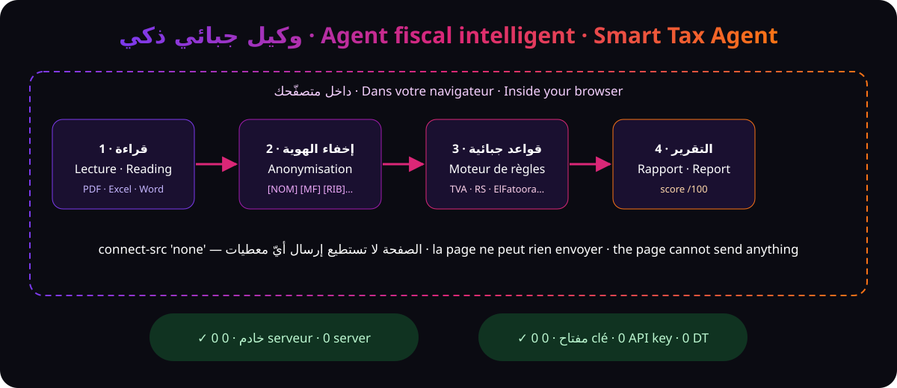
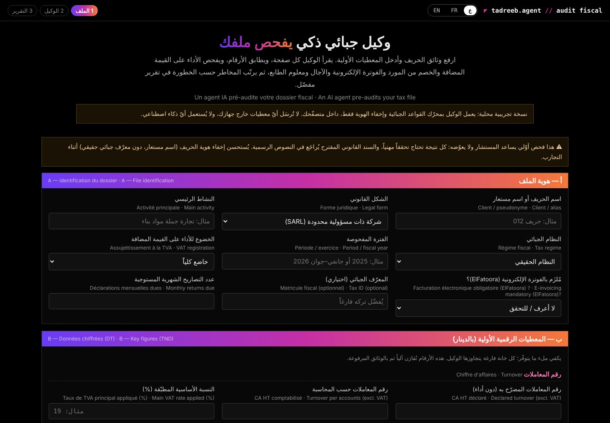
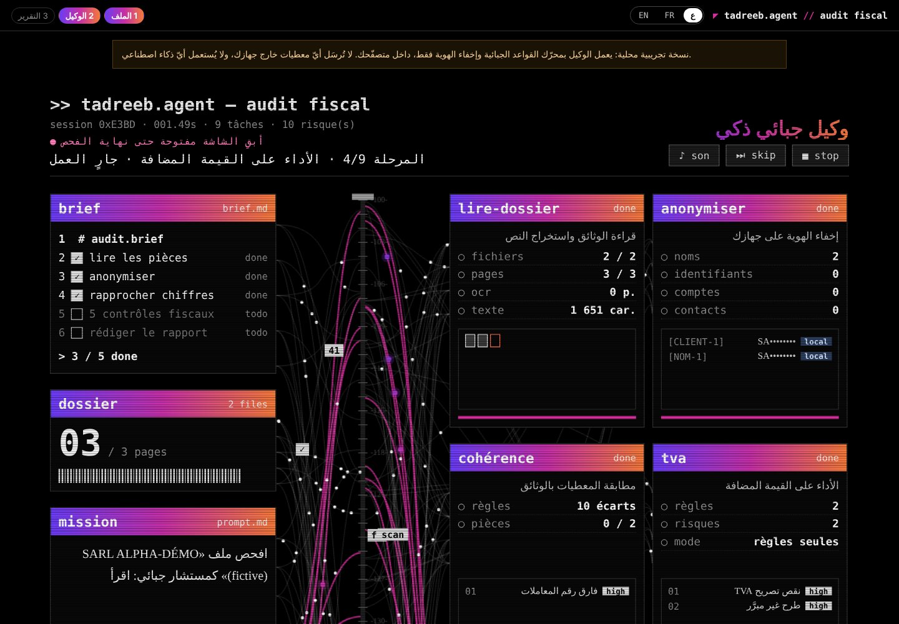

# وكيل جبائي ذكي · Agent fiscal intelligent · Smart Tax Agent

**▶ النسخة التجريبية · Démo · Live demo:** https://samehgassouma-cloud.github.io/wakil-jibai-dhaki/

---

## بالعربية

**الوكيل الجبائي الذكي** أداة للفحص الجبائي الأولي (pre-audit). يرفع المستخدم وثائق المؤسسة ومعطياتها الأولية، فيقرأ الوكيل الوثائق ويخفي الهوية، ثم يطبّق القواعد الجبائية التالية:

- الانسجام بين رقم المعاملات المصرّح به والمفوتر والمحاسبي؛
- الأداء على القيمة المضافة؛
- الخصم من المورد؛
- الفوترة الإلكترونية (ElFatoora)؛
- آجال التصاريح؛
- معلوم الطابع والدفوعات النقدية.

في النهاية يُصدر الوكيل تقريراً مرتّباً حسب الخطورة، مع مؤشّر من 100 وخطّة عمل.

هذا المشروع امتداد لمشروع **[مرشد جباية](https://github.com/samehgassouma-cloud/mourchid-jibaya)**، الذي قُدّم في الهاكاتون الوطني «الذكاء الاصطناعي والمالية العمومية» الذي نظّمته وزارة المالية. ولا يزال في طور التطوير.

### السرّية

- **النسخة المنشورة هنا تعمل كلّياً داخل المتصفّح.** لا يوجد خادم ولا ذكاء اصطناعي ولا مفتاح API.
- **الصفحة ممنوعة تقنياً من إرسال أيّ معطيات** (`Content-Security-Policy: connect-src 'none'`). الملفات التي ترفعها لا تغادر جهازك.
- **إخفاء الهوية:** تُستبدل الأسماء والمعرّفات الجبائية وبطاقات التعريف والحسابات البنكية والهواتف بالرموز التالية: [NOM‑1] و[MF‑1] و[CIN‑1] و[RIB‑1] و[TEL‑1]… ويبقى جدول المطابقة على جهازك فقط.
- **لا تترتّب عن استعمال النسخة المنشورة أيّ تكلفة**، لا عليك ولا على صاحبة المشروع.

### نسخة Claude

يحتوي المجلّد `claude-version/` على النسخة الكاملة مع التحليل بالذكاء الاصطناعي. هذه النسخة لا تعمل إلا داخل Claude (claude.ai)، وتستعمل حساب الشخص الذي يفتحها هو، لا حساب صاحبة المشروع. وهي لا تحتوي على أيّ مفتاح.

> ⚠️ أداة مساعدة لا تعوّض المستشار الجبائي. كلّ نتيجة تحتاج تحقّقاً مهنياً، والسند القانوني المقترح يُراجَع في النصوص الرسمية.

---

## Français

L'**Agent fiscal intelligent** est un outil de pré-audit fiscal. L'utilisateur dépose les pièces de l'entreprise et ses données de base. L'agent lit les documents et les anonymise. Il applique ensuite les règles fiscales suivantes :

- cohérence entre le CA déclaré, facturé et comptabilisé ;
- TVA ;
- retenues à la source ;
- facturation électronique (ElFatoora) ;
- délais de déclaration ;
- droit de timbre et paiements en espèces.

Il produit enfin un rapport classé par gravité, avec un indice sur 100 et un plan d'action.

Le projet prolonge **[Mourchid Jibaya](https://github.com/samehgassouma-cloud/mourchid-jibaya)**, présenté au Hackathon national « IA & Finances Publiques » organisé par le Ministère des Finances. Il est encore en cours de développement.

**Confidentialité**

- La version publiée ici fonctionne entièrement dans le navigateur, sans serveur, sans IA et sans clé API.
- La page n'a techniquement pas le droit d'envoyer de données (`connect-src 'none'`).
- L'anonymisation est faite en local.
- Son utilisation n'entraîne aucun coût.

Le dossier `claude-version/` contient la version complète avec IA. Elle ne fonctionne que dans Claude, sur le compte de la personne qui l'ouvre, et ne contient aucune clé.

> ⚠️ Outil d'aide qui ne remplace pas le conseiller fiscal.

---

## English

The **Smart Tax Agent** is a tax pre-audit tool. The user uploads the company's documents and basic data. The agent reads and anonymises the documents, then applies the following tax rules:

- consistency between declared, invoiced and booked turnover;
- VAT;
- withholding tax;
- e-invoicing (ElFatoora);
- filing deadlines;
- stamp duty and cash payments.

Finally, it produces a report ranked by severity, with a score out of 100 and an action plan.

It extends **[Mourchid Jibaya](https://github.com/samehgassouma-cloud/mourchid-jibaya)**, presented at the National Hackathon "AI & Public Finance" organized by the Ministry of Finance. It is still in development.

**Privacy**

- The version published here runs entirely in the browser, with no server, no AI and no API key.
- The page is technically blocked from sending any data (`connect-src 'none'`).
- Anonymisation is done locally.
- Using it costs nothing.

The `claude-version/` folder holds the full AI version. It only runs inside Claude, on the account of whoever opens it, and contains no key.

> ⚠️ A support tool, not a replacement for a tax advisor.

---

| | |
|---|---|
|  |  |

---

**الأستاذة سماح قسومة** — مستشارة جبائية · مدرّبة دولية 
**Sameh Gassouma** — Conseillère fiscale · Formatrice internationale 
**Sameh Gassouma** — Tax Advisor · International Trainer 
samehgassouma@tadreebpro.ai · [tadreebpro.ai](https://tadreebpro.ai)

© 2026 Sameh Gassouma — جميع الحقوق محفوظة · Tous droits réservés · All rights reserved.
Third-party libraries: see [vendor/LICENSES.md](vendor/LICENSES.md).
